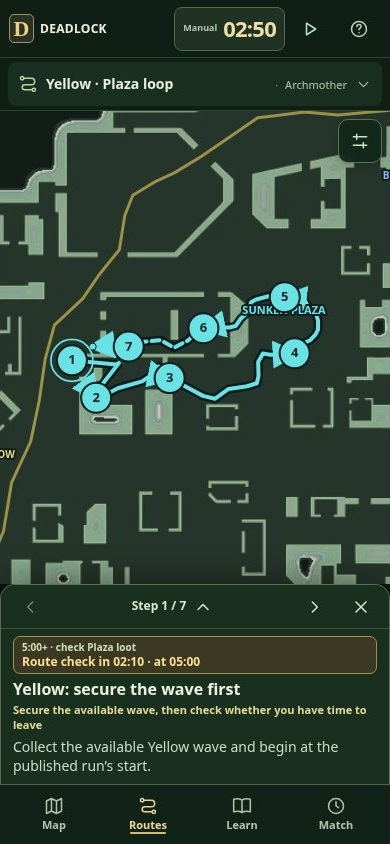

# Deadlock Field Guide

A mobile-friendly full map, published farming runs, a manual match clock and a beginner reference for Deadlock. The compact interface keeps the map, current section and start countdown visible, with supporting controls and explanations collapsed.

## Run locally

The complete static application is in `dist/`. No package installation, build step, backend or API keys are required.

```sh
git clone https://github.com/nnetraga97/deadlock.git
cd deadlock
python3 -m http.server 8000 --directory dist
```

Open <http://localhost:8000>. On Windows, use `py` instead of `python3` if needed. Serve over HTTP rather than opening `index.html` as a file, because the app fetches local JSON datasets.

For static hosting, upload the contents of `dist/` and serve `index.html` as the entry page. Relative asset paths also support hosting beneath a project subdirectory. No hosting account binding is required.

## Four published farming runs

The previous eight planning routes were removed. The catalog now uses four actual published recordings from the City Never Sleeps map. All four are **box-farming circuits that return to their lane**. A fully documented camp-and-Sinner rotation from Green to mid was not verified; no such route is invented or attributed to a creator here.

| Guide route | Team | Original recording | Source practice time | Planning check |
| --- | --- | --- | ---: | --- |
| Green: full return loop | Hidden King | Leif’s HK Right Long, recorded by oilslick | 54.45 s | 3:00+, after a pushed wave and with lane coverage |
| Green: short return loop | Archmother | Leif’s Archmother Left Short, recorded by oilslick | 25.63 s | 3:00+, after a pushed wave |
| Mid: Chinatown box circuit | Hidden King | Zappy’s Chinatown Blue box run | 31.09 s | 3:00+, after a pushed Blue wave |
| Yellow: Plaza box loop | Archmother | Zappy’s Sunken Plaza Yellow run | 34.89 s | 5:00+ check for the full Plaza loop; verify local loot |

Primary sources:

- [Leif’s optimized box routes, recorded by oilslick](https://hyperline.gg/movement/playlist/mvpkeady)
- [Zappy’s box and healing routes](https://hyperline.gg/movement/playlist/mvklxz8p)

Each route links to its original publication in its expanded overview. Source dates, builds, revisions, reference durations and point counts are saved in `dist/assets/routes-data.json`. The audit manifest with source hashes is `docs/route-source-evidence.json`.

### Map and timing evidence

The four paths preserve **245 recorded coordinates in order**. Clickable sections use consecutive portions of those traces, rather than curves between selected camps. Each route keeps its actual team; no mirrored variants are manufactured. The team selector filters the catalog.

```js
mapX = 500 + worldX / 21504 * 1000;
mapY = 500 - worldY / 21504 * 1000;
```

The 28 numbered sections are guide annotations. The original records name only Start and Finish. Their public samples contain X/Y coordinates and ticks, but no floor heights, pickup events or collected-soul inventories. Use the source reference for doors, jumps and vertical movement. Nearby map resources do not prove the recording collected them.

Match-start checks are separate from practice duration. Surface breakables usually begin at 3:00. The Plaza route uses a conservative 5:00 planning check because its complete circuit enters an area with vault/tunnel timing exceptions; this is not a claim that every box there has a confirmed universal spawn time.

The source recordings were published October 23–26 on game build 6819. The selected Leif recordings list practice settings including a 100 stamina budget, no items and a maximum level of 36. Zappy’s public records omit restrictions. Their times do not promise a beginner’s clear time or a safe interval away from lane. The October 30 patch also changed breakable growth and tunnel movement speed.

Secure the wave, assess the next wave, your partner and enemy positions, then start only when the gap allows it. Return early if those conditions change. Camp kills and Sinner jackpots are not added to these recordings.

## Clock, map and mobile behavior

Tap the visible clock to match the game, then use play/pause. It drives route checks, selected targets, resource returns and Match guidance. Minute adjustments remain drafts until Set time is pressed; Cancel, Escape and closing discard them.

Map layers cover camps, loot, structures, shops, objectives and movement utilities. Select a location for access notes and timing. Record a complete clear to start its expected return; moving to the next route section never records one. The app does not connect to a live match.

One route chooser holds four recordings and a team filter. One map picker opens layer/subtype choices. Zoom, rotation, fit, expansion and the legend sit behind map tools. Phones retain the 200px route card and single previous/next/expand/close toolbar. Long instructions scroll. Learn and Match keep supporting material in disclosures.



## Rewards and sources

The recordings lack verified pickup counts. Their pages therefore show no zero-soul or fabricated route total, and no souls-per-minute claim. An expanded loot reference retains current per-box values; regular boxes use expected drops and tough boxes give a guaranteed payout. Availability, sharing and modifiers still affect actual income.

Gameplay references remain attached to map datasets and lessons, separately from route geometry attribution. Background references include [Crate timing](https://deadlock.wiki/Crate), [AndrewChicken’s route adaptation and vault-timing observation](https://guides-factory.com/guides/deadlock-farming-guide), and [Valve’s October 30 update](https://steamcommunity.com/games/1422450/announcements/detail/680765564125186046).

## Development

| Path | Responsibility |
| --- | --- |
| `dist/index.html` | Layout, dialogs, navigation and icons |
| `dist/app.js` | Recorded paths, sections, sources and route checks |
| `dist/field-guide.js` | Map layers, location details, lessons and Match |
| `dist/match-clock.js` | Manual clock and resource-return estimates |
| `dist/styles.css`, `dist/compact-ui.css` | Responsive layout and controls |
| `dist/assets/routes-data.json` | Four published paths and annotations |
| Other `dist/assets/*.json` | Map inventory, timing and beginner content |
| `dist/sw.js`, `dist/manifest.webmanifest` | Offline cache and app metadata |
| `docs/` | Source audit manifest and UI screenshots |

Edit static files directly. Update the release cache name and script/style queries when shipping changes. Cache version 6 includes the revised routes. The service worker registers only on HTTPS; local HTTP works without offline caching. Preferences and manual timing records stay in browser local storage.

```sh
node --check dist/app.js
node --check dist/field-guide.js
node --check dist/match-clock.js
node --check dist/sw.js
```

Route validation checks every saved point against its public recording, original order and side, and that all annotations are indexed points on the path. Responsive browser checks cover selection/filtering, clickable lines, countdowns, source disclosures and navigation. These checks do not constitute in-game replay or physical-device testing.

Map artwork belongs to Valve; community attributions remain in the data. Third-party artwork is not relicensed by this repository. This is an unofficial companion guide.
